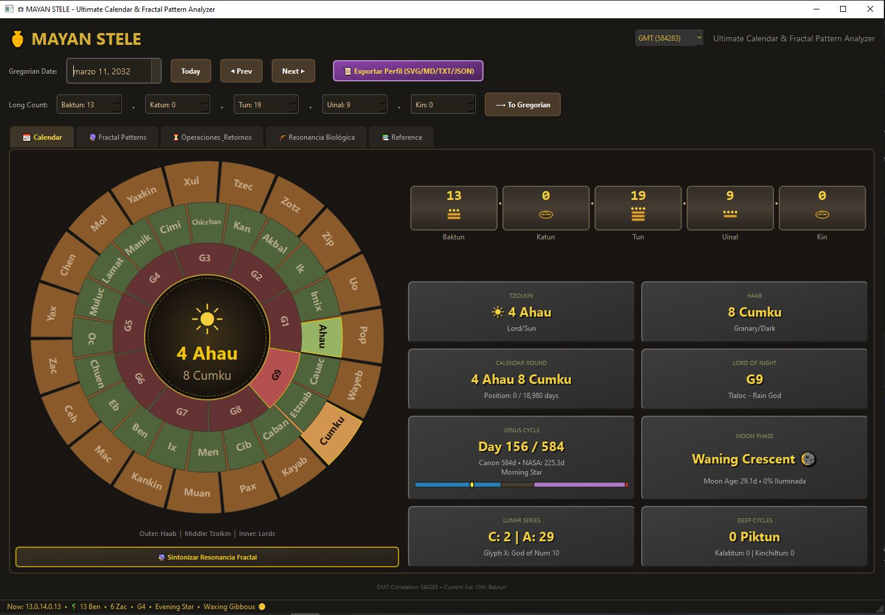
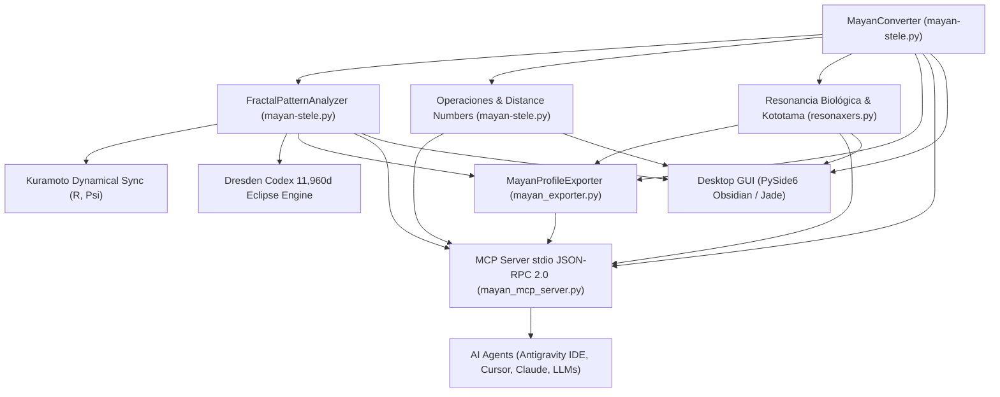

# Mayan Stele - Ultimate Calendar, Fractal Pattern Analyzer & MCP Server

A comprehensive, mathematically rigorous Mayan calendar application and **Model Context Protocol (MCP)** server built with Python and PySide6. Convert any Gregorian date to its exact Mayan equivalent, compute Kuramoto phase synchronization across planetary cycles, detect Dresden Codex eclipse windows, explore biocymatic/genetic resonances, and empower AI agents to interact with ancient mesoamerican chronometry.



[](https://python.org)
[-41CD52?logo=qt&logoColor=white)](https://pypi.org/project/PySide6/)
[](https://modelcontextprotocol.io)
[](./LICENSE)

---

## Table of Contents

1. [Architectural Overview](#architectural-overview)
2. [Model Context Protocol (MCP) Server for AI Agents](#model-context-protocol-mcp-server-for-ai-agents)
   - [Why MCP for Mayan Epigraphy?](#why-mcp-for-mayan-epigraphy)
   - [Client Setup (Antigravity IDE, Cursor, Claude Desktop)](#client-setup)
   - [Available MCP Tools Reference](#available-mcp-tools-reference)
   - [Example Agent Queries & Responses](#example-agent-queries--responses)
3. [Advanced Chronometry & Astronomical Engines](#advanced-chronometry--astronomical-engines)
   - [Kuramoto Coupled Oscillators Synchronization ($R, \Psi$)](#kuramoto-coupled-oscillators-synchronization)
   - [Dresden Codex Eclipse Warning Engine](#dresden-codex-eclipse-warning-engine)
   - [Deep Time Eras (up to Alautun)](#deep-time-eras)
   - [Correlation Constants](#correlation-constants)
4. [Desktop GUI Application (`mayan-stele.py`)](#desktop-gui-application)
   - [Astronomical Calendar & Rotating Wheel](#astronomical-calendar--rotating-wheel)
   - [Fractal Pattern Analyzer & Soliton Wave Packets](#fractal-pattern-analyzer--soliton-wave-packets)
   - [⏳ Operaciones & Retornos (Distance Numbers & CRT)](#operaciones--retornos)
   - [🧬 Resonancia Biológica (Amino Acids, Codons & Kototama)](#resonancia-biológica)
   - [Encyclopedia & Basalt/Obsidian Styling](#encyclopedia--styling)
5. [Multi-Format Profile Exporter (`mayan_exporter.py`)](#multi-format-profile-exporter)
6. [Installation & Quickstart](#installation--quickstart)
7. [License & Acknowledgments](#license--acknowledgments)

---

## Architectural Overview

The repository consists of four core modular engines working seamlessly together:



---

## Model Context Protocol (MCP) Server for AI Agents

The **Mayan Stele MCP Server** (`mayan_mcp_server.py`) implements the official **Model Context Protocol (MCP)** specification via standard input/output (`stdio`) using JSON-RPC 2.0. 

### Why MCP for Mayan Epigraphy?
Large Language Models frequently struggle with non-linear calendar arithmetic, modular residue calculations, and non-congruent orbital periods. The MCP server bridges LLMs directly to verified algorithmic engines:
- **Zero Shot**: Precise integer mathematics for Long Counts, Tzolk'in day signs, and Haab' dates.
- **Continuous Cosmic Coherence**: Computes the complex Kuramoto order parameter $R e^{i\Psi}$ and Dresden nodal eclipse warnings for any epoch.
- **Biomolecular Mapping**: Cross-references Tzolk'in solar seals with genetic codons, amino acids, and Kototama sound matrices.
- **Multiformat Generation**: Direct programmatic export to SVG, Markdown, ASCII, and JSON.

### Client Setup

#### 1. Google Antigravity IDE
Add the server configuration to your MCP settings or plugin directory:
```json
{
  "mcpServers": {
    "mayan-calendar": {
      "command": "python",
      "args": [
        "g:/GitHub/MayanCalendar-main/MayanCalendar-main/mayan_mcp_server.py"
      ],
      "env": {
        "PYTHONIOENCODING": "utf-8"
      }
    }
  }
}
```

#### 2. Cursor IDE (`.cursor/mcp.json`)
```json
{
  "mcpServers": {
    "mayan-calendar": {
      "command": "python",
      "args": [
        "mayan_mcp_server.py"
      ],
      "env": {
        "PYTHONIOENCODING": "utf-8"
      }
    }
  }
}
```

#### 3. Claude Desktop (`claude_desktop_config.json`)
```json
{
  "mcpServers": {
    "mayan-calendar": {
      "command": "python",
      "args": [
        "g:\\GitHub\\MayanCalendar-main\\MayanCalendar-main\\mayan_mcp_server.py"
      ],
      "env": {
        "PYTHONIOENCODING": "utf-8"
      }
    }
  }
}
```

> **Note for Windows Users**: The server automatically forces UTF-8 encoding across `stdin`, `stdout`, and `stderr`, preventing character corruption with glyph symbols or mathematical markers.

---

### Available MCP Tools Reference

The server exposes **9 specialized tools**:

| Tool Name | Purpose | Key Arguments |
|-----------|---------|---------------|
| `mayan_convert_gregorian` | Gregorian date $\to$ complete Mayan calendar system | `year`, `month`, `day`, `correlation` |
| `mayan_convert_long_count` | Long Count (Baktun..Kin) $\to$ Gregorian date | `baktun`, `katun`, `tun`, `uinal`, `kin`, `correlation` |
| `mayan_add_distance_number` | Epigraphic Distance Number chronological vector addition | `base_year`, `base_month`, `base_day`, `direction`, `katun`, `tun`, `uinal`, `kin` |
| `mayan_calculate_resonance` | Harmonic score ($0-100\%$), Kuramoto order parameter ($R, \Psi$), Dresden eclipse alert | `year`, `month`, `day`, `natal_year`, `natal_month`, `natal_day`, `selected_cycles` |
| `mayan_find_convergences` | Range scanner detecting wave packets, solitons ($>60\%$) & harmonic bridges | `start_year`, `start_month`, `start_day`, `total_days`, `min_score`, `natal_year` |
| `mayan_exact_cycle_returns` | Chinese Remainder Theorem (CRT) modular solver for multi-cycle returns | `start_year`, `cycle1_name`, `cycle1_target`, `cycle2_name`, `cycle2_target` |
| `mayan_project_pattern` | Projects cyclic harmonic steps forward or backward | `base_year`, `base_month`, `base_day`, `interval_days`, `count` |
| `mayan_get_biomolecular_profile` | Maps Tzolk'in solar seal to amino acids, RNA codons & Kototama | `tzolkin_sign` (e.g. `Ahau`, `Imix`, `Cauac`) |
| `mayan_export_profile` | Generates full profile in SVG, Markdown, ASCII, or JSON format | `year`, `month`, `day`, `format`, `correlation` |

---

### Example Agent Queries & Responses

#### Query: `mayan_calculate_resonance` for March 11, 2032
```json
{
  "name": "mayan_calculate_resonance",
  "arguments": {
    "year": 2032,
    "month": 3,
    "day": 11
  }
}
```
**Response Payload**:
```json
{
  "date": "2032-03-11",
  "long_count": "13.0.19.9.0",
  "tzolkin": "4 Ahau",
  "haab": "8 Cumku",
  "harmonic_score_percent": 78.3,
  "kuramoto_order_parameter": {
    "R_coherence_percent": 57.6,
    "psi_phase_deg": 35.8,
    "state": "Coherente (Phase-locked)"
  },
  "dresden_eclipse": {
    "active": true,
    "type": "Solar (Luna Nueva)",
    "days_to_node": 1.2,
    "window_description": "Ventana de Eclipse Dresden activa (Alerta Solar / Nodo cercano)"
  },
  "active_alignments": [
    "Tzolkin",
    "Haab",
    "Tun",
    "Venus",
    "Calendar Round",
    "Dresden Solar (Luna Nueva)"
  ]
}
```

#### Query: `mayan_get_biomolecular_profile` for "Ahau"
```json
{
  "name": "mayan_get_biomolecular_profile",
  "arguments": {
    "tzolkin_sign": "Ahau"
  }
}
```
**Response Payload**:
```json
{
  "sign": "Ahau",
  "kiche_name": "Junajpu",
  "meaning": "Sol, Iluminación, Maestría Universal",
  "amino_acid": "Triptófano (Trp / W)",
  "codons": ["UGG"],
  "polarity": "Apolar aromático hidrófobo",
  "biological_role": "Precursor de serotonina y melatonina, antena electromagnética",
  "kototama_vowel": "A",
  "kototama_consonant": "WA",
  "bija_mantra": "OM / RAM",
  "element": "Fuego / Luz Solar"
}
```

---

## Advanced Chronometry & Astronomical Engines

### Kuramoto Coupled Oscillators Synchronization

In addition to traditional modular returns (Day 0), the engine models the solar system and Mesoamerican cycles as a network of **$N=8$ coupled non-linear phase oscillators** governed by the Kuramoto order parameter:

$$r e^{i\psi} = \frac{1}{N} \sum_{j=1}^{N} e^{i \theta_j(t)}$$

Where:
- $\theta_j(t) = 2\pi \frac{(t - t_{0,j}) \pmod{T_j}}{T_j}$ is the instantaneous phase of cycle $j$.
- $R = |r| \in [0, 1]$ measures the **macroscopic phase coherence** ($0\%$ = complete dispersion, $100\%$ = perfect phase alignment).
- $\Psi \in [0, 360^\circ)$ represents the **collective cosmic phase angle**.

Coupled cycles include:
1. **Tzolk'in** ($260$ days)
2. **Haab'** ($365$ days)
3. **Tún** ($360$ days)
4. **Venus Synodic Period** ($584$ days)
5. **K'awiil Sacred Quadripartite Cycle** ($819$ days)
6. **Lunar Synodic Period** ($29.530588$ days)
7. **Draconic Eclipse Half-Year** ($173.31$ days)
8. **Dresden Great Eclipse Cycle** ($11,960$ days)

When $R > 50\%$, the cycles enter constructive resonance, forming **Soliton wave packets** in the time continuum.

---

### Dresden Codex Eclipse Warning Engine

Based on pages 51–58 of the **Dresden Codex**, the Maya tracked eclipses using a master cycle of **11,960 days** ($405$ lunations $= 46$ Tzolk'in $\approx 32.7$ tropical years). 

The engine evaluates syzygies against the lunar node passages:
- **Eclipse Node Period**: $T_{\text{node}} = 173.31$ days (the Draconic half-year).
- **Node Distance**: $\Delta t_{\text{node}} = \min(t \pmod{173.31}, 173.31 - (t \pmod{173.31}))$.
- If $\Delta t_{\text{node}} \le 15.0$ days, the date falls within an astronomical eclipse corridor:
  - **Solar Eclipse Warning**: If Moon Phase is near New Moon ($0^\circ \pm 30^\circ$ or $330^\circ-360^\circ$).
  - **Lunar Eclipse Warning**: If Moon Phase is near Full Moon ($180^\circ \pm 30^\circ$).

---

### Deep Time Eras

The Maya Long Count extends far beyond the 13 Baktun creation era:

| Unit | Factor | Exact Days | Gregorian Span |
|------|--------|------------|----------------|
| **K'in** | 1 | 1 | 1 Day |
| **Uinal** | 20 K'in | 20 | 20 Days |
| **Tún** | 18 Uinal | 360 | ~0.986 Years |
| **Katún** | 20 Tún | 7,200 | ~19.71 Years |
| **Baktún** | 20 Katún | 144,000 | ~394.26 Years |
| **Piktún** | 20 Baktún | 2,880,000 | ~7,885 Years |
| **Kalabtún** | 20 Piktún | 57,600,000 | ~157,704 Years |
| **K'inchiltún** | 20 Kalabtún | 1,152,000,000 | ~3,154,079 Years |
| **Alautún** | 20 K'inchiltún | 23,040,000,000 | ~63,081,588 Years |

---

### Correlation Constants

Users and agents can switch instantly between recognized correlation constants:
- **GMT (584283)**: Standard archaeological consensus (Goodman-Martínez-Thompson).
- **GMT+2 (584285)**: Astronomical correlation aligning historical eclipses and radiocarbon dates.
- **Spinden (489384)**: Early 20th-century correlation (13.0.0.0.0 = 3373 BCE).

---

## Desktop GUI Application

Built with **PySide6** and styled with an authentic stone-carved, basalt obsidian, jade, and gold visual theme.

```
┌────────────────────────────────────────────────────────────────────────┐
│  MAYAN STELE - COSMIC CHRONOMETRY & FRACTAL ANALYZER                   │
├────────────────────────────────────────────────────────────────────────┤
│  [📅 Calendario & Estela]  [🌀 Analizador Fractal]                     │
│  [⏳ Operaciones & Retornos] [🧬 Resonancia Biológica] [📚 Enciclopedia]│
└────────────────────────────────────────────────────────────────────────┘
```

### 1. Calendario & Estela
- **Interactive Rotary Wheel**: Concentric rings for Haab' months, Tzolk'in days, Lords of the Night, and Lunar Glyphs.
- **Glyph Cartouches**: Vectorized iconography for Day Signs and Glyphs A, C, X.
- **Live Clock & Deep Time Counter**: Real-time ticking odometer displaying cosmic coordinates.

### 2. Analizador Fractal
- **Continuous Kuramoto Gauge**: Visual indicator showing collective phase coherence $R$ and angle $\Psi$.
- **Dresden Codex Warning Banner**: Highlights active solar/lunar eclipse corridors.
- **Wave Packet & Soliton Table**: Identifies multi-day convergence clusters where multiple sacred periods coincide.
- **Personal Natal Resonance**: Computes individualized alignment scores with personal birth matrices.

### 3. ⏳ Operaciones & Retornos
- **Distance Numbers**: Add or subtract historical vectors ($k$ Katún, $t$ Tún, $u$ Uinal, $k$ K'in) to any epoch.
- **CRT Exact Cycle Solver**: Solves simultaneous modular congruences using the Chinese Remainder Theorem:
  - *Calendar Round Return* (Tzolk'in + Haab' = 18,980 days / ~52 years)
  - *Venus Great Cycle* (Tzolk'in + Venus = 37,960 days / ~104 years)
  - *Tzolk'in-Tún Grand Conjunction* (260 + 360 = 93,600 days / 260 Tún)
- **Harmonic Pattern Projector**: Projects forward/backward steps over arbitrary cycle frequencies.

### 4. 🧬 Resonancia Biológica
- **20 Solar Seals $\to$ 20 Amino Acids**: Symmetrical mapping grounded in molecular charge, hydropathy, and aromaticity.
- **RNA Genetic Triplets**: Direct codon assignments for every Tzolk'in sign.
- **Kototama Phonetics & Bīja Mantras**: Traditional vocalic frequencies associated with daily vibrational archetypes.

### 5. 📚 Enciclopedia & Basalt Obsidian Styling
- Comprehensive scholarly reference for all 13 Galactic Tones, 9 Underworld Lords, Venus Helical Risings, and Lunar Patrons.
- Seamless Dark Obsidian and Basque Gold CSS palettes without white artifact bleeds.

---

## Multi-Format Profile Exporter (`mayan_exporter.py`)

Generate full chronological and epigraphic dossiers directly from the GUI or via the MCP server:

- **SVG Vector Stele (`.svg`)**: Hieroglyphic stone slab illustration containing Long Count glyphs, Tzolk'in/Haab' cartouches, Kuramoto synchronization wheel, and biocymatic glyphs.
- **Markdown Dossier (`.md`)**: Comprehensive research report with mathematical tables, alignments, and biological correspondences.
- **ASCII Monument (`.txt`)**: Terminal-rendered ancient monument banner suitable for text consoles.
- **JSON Payload (`.json`)**: Full structured machine-readable document for pipelines and LLM ingestion.

---

## Installation & Quickstart

### Prerequisites
- Python 3.8 or higher
- Windows, macOS, or Linux

### Setup
```bash
# Clone repository
git clone https://github.com/plantacerium/MayanCalendar.git
cd MayanCalendar

# Create virtual environment (optional but recommended)
python -m venv .venv
source .venv/bin/activate  # On Windows: .venv\Scripts\activate

# Install dependencies
pip install PySide6
```

### Launch the GUI
```bash
python mayan-stele.py
```

### Run the MCP Server Standalone
```bash
python mayan_mcp_server.py
```

---

## Historical & Significant Dates to Explore

| Gregorian Date | Long Count | Tzolk'in | Haab' | Cosmic Context |
|----------------|------------|----------|-------|----------------|
| **Aug 11, 3114 BCE** | 0.0.0.0.0 | 4 Ahau | 8 Cumku | Maya Creation Epoch |
| **Dec 21, 2012** | 13.0.0.0.0 | 4 Ahau | 3 Kankin | Completion of the 13th Baktún |
| **Dec 01, 0940** | 10.5.12.6.0 | 4 Ahau | 8 Cumku | Peak Wave Packet W13 (80.0% Harmonic Score) |
| **Mar 11, 2032** | 13.0.19.9.0 | 4 Ahau | 8 Cumku | Soliton W72, $R=57.6\%$, Dresden Solar Eclipse Window |
| **Jan 02, 2045** | 13.1.12.9.0 | 4 Ahau | 8 Cumku | Soliton W3, Dresden Lunar Eclipse Window |

---

## License & Citation

Distributed under the **GPL V3 License**. See [`LICENSE`](./LICENSE) for full details.

If you use this software or the MCP server in your research, computational chronometry, or agentic systems, please cite:

```bibtex
@software{mayan_stele_mcp_2026,
  author = {Plantacerium and Contributors},
  title = {Mayan Stele: Ultimate Calendar, Fractal Pattern Analyzer & MCP Server},
  year = {2026},
  url = {https://github.com/plantacerium/MayanCalendar}
}
```

---

*"Time is not an arrow, but a symphony of concentric spirals resonating across deep space."*
