# Mayan Stele - Ultimate Calendar, Fractal Pattern Analyzer & MCP Server

A comprehensive, mathematically rigorous Mayan calendar application and **Model Context Protocol (MCP)** server built with Python and PySide6. Convert any Gregorian date to its exact Mayan equivalent, compute Kuramoto phase synchronization across planetary cycles, detect Dresden Codex eclipse windows, explore biocymatic/genetic resonances, and empower AI agents to interact with ancient mesoamerican chronometry.

## App Calendar mayan-stele.py
<p align="center">
  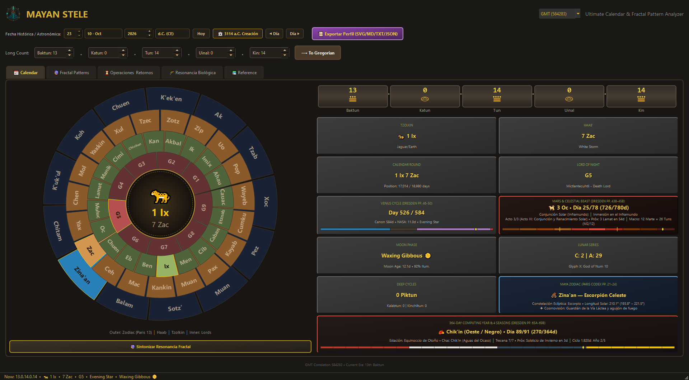
</p>

<p align="center">
  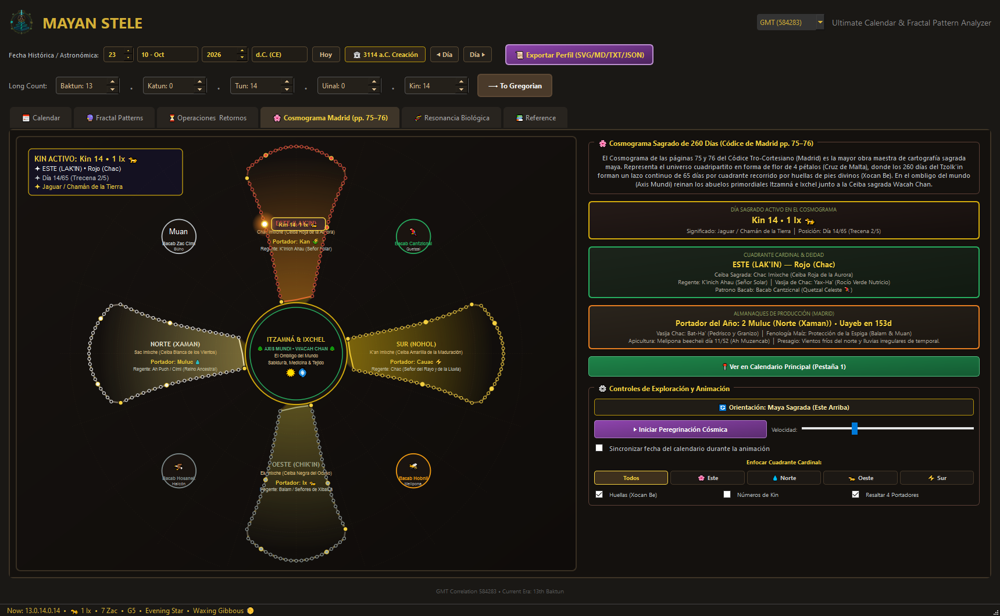
</p>

## App Language mayan-lang.py
<p align="center">
  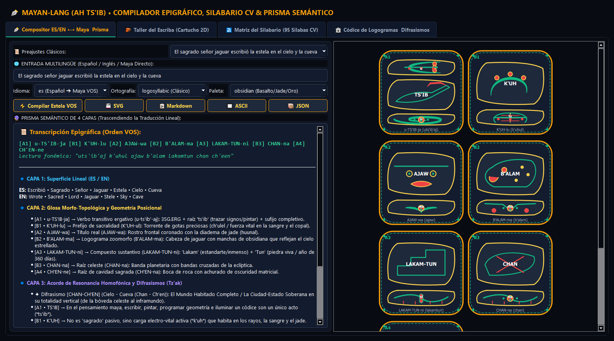
</p>

[](https://python.org)
[-41CD52?logo=qt&logoColor=white)](https://pypi.org/project/PySide6/)
[](https://modelcontextprotocol.io)
[](./LICENSE)

---

## Logo
<p align="center">
  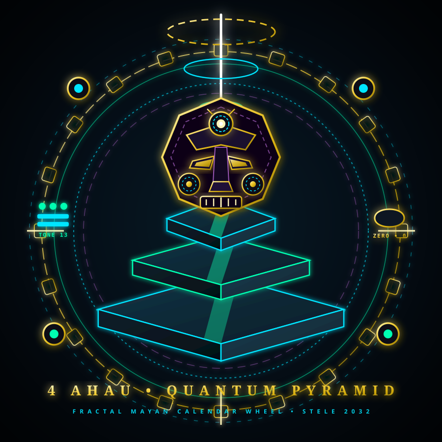
</p>

---

## Table of Contents

1. [Architectural Overview](#architectural-overview)
2. [Model Context Protocol (MCP) Server for AI Agents](#model-context-protocol-mcp-server-for-ai-agents)
   - [Why MCP for Mayan Epigraphy?](#why-mcp-for-mayan-epigraphy)
   - [Client Setup (Antigravity IDE, Cursor, Claude Desktop)](#client-setup)
   - [Available MCP Tools Reference](#available-mcp-tools-reference)
   - [Example Agent Queries & Responses](#example-agent-queries--responses)
3. [Advanced Chronometry & Astronomical Engines](#advanced-chronometry--astronomical-engines)
   - [Kuramoto Coupled Oscillators Synchronization ($R, \Psi$)](#kuramoto-coupled-oscillators-synchronization)
   - [Dresden Codex Eclipse Warning Engine](#dresden-codex-eclipse-warning-engine)
   - [Dresden Codex Mars Table & The Celestial Beast (pp. 43b–45b)](#dresden-codex-mars-table--the-celestial-beast-pp-43b45b)
   - [Madrid Codex: Year Bearers, Rain & Maize Almanacs (Tro-Cortesiano)](#madrid-codex-year-bearers-rain--maize-almanacs-tro-cortesiano)
   - [Deep Time Eras (up to Alautun)](#deep-time-eras)
   - [Correlation Constants](#correlation-constants)
4. [Desktop GUI Application (`mayan-stele.py`)](#desktop-gui-application)
   - [Astronomical Calendar & Rotating Wheel](#astronomical-calendar--rotating-wheel)
   - [Fractal Pattern Analyzer & Soliton Wave Packets](#fractal-pattern-analyzer--soliton-wave-packets)
   - [⏳ Operaciones & Retornos (Distance Numbers & CRT)](#operaciones--retornos)
   - [🌸 Cosmograma de Madrid (pp. 75–76) — Flor de 4 Pétalos](#cosmograma-de-madrid-pp-7576)
   - [🧬 Resonancia Biológica (Amino Acids, Codons & Kototama)](#resonancia-biológica)
   - [Encyclopedia & Basalt/Obsidian Styling](#encyclopedia--styling)
5. [Mayan Epigraphy & Linguistic Engine: Ah Ts'ib (`mayan-lang.py`)](#mayan-epigraphy--linguistic-engine-ah-tsib-mayan-langpy)
   - [📜 Compositor ES/EN ➔ Maya & Prisma Semántico de 4 Capas](#1--compositor-esen--maya--prisma-semántico-de-4-capas)
   - [🖋️ Taller del Escriba (Cartucho 2D Topológico)](#2-️-taller-del-escriba-cartucho-2d-topológico)
   - [🔣 Matriz del Silabario Fonético (95 Sílabas CV & Resonancia Kototama)](#3--matriz-del-silabario-fonético-95-sílabas-cv--resonancia-kototama)
   - [🏛️ Corpus Thompson (+860 Glifos Mayas: T1–T1066) & Códice](#4-️-corpus-thompson-860-glifos-mayas-t1t1066--códice)
6. [Multi-Format Profile Exporter (`mayan_exporter.py`)](#multi-format-profile-exporter)
7. [Installation & Quickstart](#installation--quickstart)
8. [License & Acknowledgments](#license--acknowledgments)

---

## Architectural Overview

The repository consists of four core modular engines working seamlessly together:

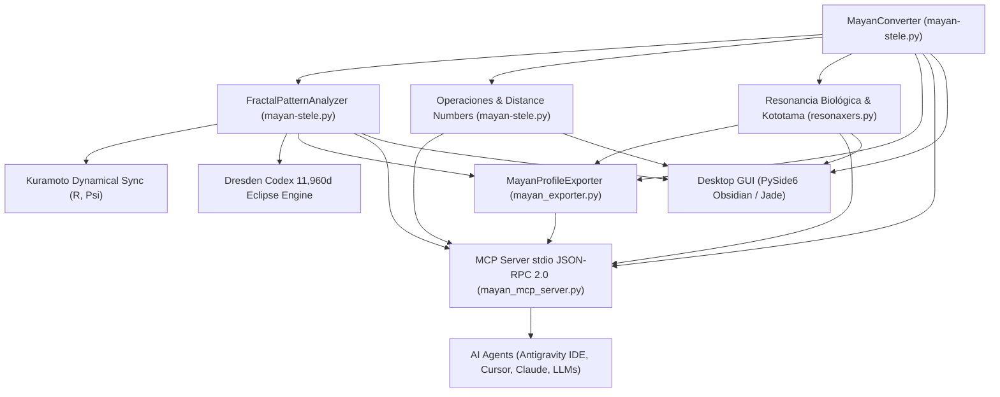

---

## Model Context Protocol (MCP) Server for AI Agents

The **Mayan Stele MCP Server** (`mayan_mcp_server.py`) implements the official **Model Context Protocol (MCP)** specification via standard input/output (`stdio`) using JSON-RPC 2.0. 

### Why MCP for Mayan Epigraphy?
Large Language Models frequently struggle with non-linear calendar arithmetic, modular residue calculations, and non-congruent orbital periods. The MCP server bridges LLMs directly to verified algorithmic engines:
- **Zero Shot**: Precise integer mathematics for Long Counts, Tzolk'in day signs, and Haab' dates.
- **Continuous Cosmic Coherence**: Computes the complex Kuramoto order parameter $R e^{i\Psi}$ and Dresden nodal eclipse warnings for any epoch.
- **Biomolecular Mapping**: Cross-references Tzolk'in solar seals with genetic codons, amino acids, and Kototama sound matrices.
- **Multiformat Generation**: Direct programmatic export to SVG, Markdown, ASCII, and JSON.

### Client Setup

#### 1. Google Antigravity IDE
Add the server configuration to your MCP settings or plugin directory:
```json
{
  "mcpServers": {
    "mayan-calendar": {
      "command": "python",
      "args": [
        "g:/GitHub/MayanCalendar-main/MayanCalendar-main/mayan_mcp_server.py"
      ],
      "env": {
        "PYTHONIOENCODING": "utf-8"
      }
    }
  }
}
```

#### 2. Cursor IDE (`.cursor/mcp.json`)
```json
{
  "mcpServers": {
    "mayan-calendar": {
      "command": "python",
      "args": [
        "mayan_mcp_server.py"
      ],
      "env": {
        "PYTHONIOENCODING": "utf-8"
      }
    }
  }
}
```

#### 3. Claude Desktop (`claude_desktop_config.json`)
```json
{
  "mcpServers": {
    "mayan-calendar": {
      "command": "python",
      "args": [
        "g:\\GitHub\\MayanCalendar-main\\MayanCalendar-main\\mayan_mcp_server.py"
      ],
      "env": {
        "PYTHONIOENCODING": "utf-8"
      }
    }
  }
}
```

> **Note for Windows Users**: The server automatically forces UTF-8 encoding across `stdin`, `stdout`, and `stderr`, preventing character corruption with glyph symbols or mathematical markers.

---

### Available MCP Tools Reference

The unified server exposes **24 specialized tools** across high-precision astronomy, chronometry, and epigraphy:

| Tool Name | Purpose | Key Arguments |
|-----------|---------|---------------|
| `mayan_convert_gregorian` | Gregorian date $\to$ complete Mayan calendar system | `year`, `month`, `day`, `correlation` |
| `mayan_convert_long_count` | Long Count (Baktun..Kin) $\to$ Gregorian date | `baktun`, `katun`, `tun`, `uinal`, `kin`, `correlation` |
| `mayan_add_distance_number` | Epigraphic Distance Number chronological vector addition | `base_year`, `base_month`, `base_day`, `direction`, `katun`, `tun`, `uinal`, `kin` |
| `mayan_calculate_resonance` | Harmonic score ($0-100\%$), Kuramoto order parameter ($R, \Psi$), Dresden eclipse alert | `year`, `month`, `day`, `natal_year`, `natal_month`, `natal_day`, `selected_cycles` |
| `mayan_find_convergences` | Range scanner detecting wave packets, solitons ($>60\%$) & harmonic bridges | `start_year`, `start_month`, `start_day`, `total_days`, `min_score`, `natal_year` |
| `mayan_exact_cycle_returns` | Chinese Remainder Theorem (CRT) modular solver for multi-cycle returns | `start_year`, `cycle1_name`, `cycle1_target`, `cycle2_name`, `cycle2_target` |
| `mayan_project_pattern` | Projects cyclic harmonic steps forward or backward | `base_year`, `base_month`, `base_day`, `interval_days`, `count` |
| `mayan_get_biomolecular_profile` | Maps Tzolk'in solar seal to amino acids, RNA codons & Kototama | `tzolkin_sign` (e.g. `Ahau`, `Imix`, `Cauac`) |
| `mayan_get_paris_zodiac` | Paris Codex (pp. 21-24) 13 Maya Ecliptic Constellations (Meeus solar algorithm) | `year`, `month`, `day` (optional: omit for full catalog) |
| `mayan_resolve_serpent_series` | Dresden Codex (pp. 61–69) Serpent Series & Ring Numbers Deep Time calculator (~33,000 yrs) | `serpent_index` (0–4) or `ring_days` + `serpent_distance_days`, `correlation` |
| `mayan_get_364_day_season` | Dresden Codex (pp. 65a–69b) 364-Day Seasonal Year & 4 Cardinal Quarters (Chac deities, 91d stations, 1,820d cycle) | `year`, `month`, `day`, `correlation` |
| `mayan_get_mars_table` | Dresden Codex (pp. 43b–45b) 780-day Mars Synodic Table & Celestial Beast Retrograde Loop (10x78d stations, 9,360d & 56,940d macro-cycles) | `year`, `month`, `day`, `correlation` |
| `mayan_get_year_bearer_and_agriculture` | Madrid Codex (pp. 34–37, 12–33, 103–112) Year Bearers (*Cuch Hab*), Uayeb countdown, Chac rain vessels, maize phenology (*Ixim*) & Melipona beekeeping (*Ah Muzencab*) | `year`, `month`, `day`, `correlation` |
| `mayan_export_profile` | Generates full profile in SVG, Markdown, ASCII, or JSON format | `year`, `month`, `day`, `format`, `correlation` |
| `mayan_translate_to_epigraphy` | Natural language (ES/EN) $\to$ Classical Mayan VOS syntax + 4-Layer Semantic Prism + full SVG stela | `text`, `source_lang`, `orthography_mode`, `theme`, `include_svg` |
| `mayan_syllabify_word` | Decomposes words into 95 CV syllables with synharmonic/disharmonic rules & Kototama Hz | `word`, `vowel_harmony` |
| `mayan_compose_glyph_block` | Assembles a 2D cartouche block (Superfix, Prefix, Main, Infix, Subfix, Postfix) | `main_sign`, `superfix`, `prefix`, `infix`, `subfix`, `postfix`, `numeral`, `theme` |
| `mayan_search_epigraphic_lexicon` | Epigraphic lexicon search across syllables, logograms, and diphrasisms | `query`, `category` |
| `mayan_export_stele_inscription` | Multi-format exporter for epigraphic inscriptions (SVG, Markdown, ASCII, JSON) | `text`, `source_lang`, `format`, `theme` |
| `mayan_get_syllabary_matrix` | Returns full 19x5 syllabary grid with Thompson codes & Kototama acoustics (Hz) | `vowel_filter`, `consonant_filter` |
| `mayan_morph_cephalomorphic_glyph` | Continuous EFD Fourier morphing ($\alpha \in [0, 1]$) between geometric and cephalomorphic | `glyph_name`, `alpha`, `theme` |
| `mayan_get_thompson_glyph` | Retrieves archaeological dossier + standalone SVG vector for any Thompson sign (T1–T1066) | `t_code`, `theme`, `size` |
| `mayan_search_corpus_800` | Free-text and category search across the entire +860 Thompson Glyph Corpus | `query`, `category`, `limit` |
| `mayan_list_thompson_categories` | Lists all 8 taxonomic families with descriptions and live glyph counts | *(none)* |

---

### Example Agent Queries & Responses

#### Query: `mayan_calculate_resonance` for March 11, 2032
```json
{
  "name": "mayan_calculate_resonance",
  "arguments": {
    "year": 2032,
    "month": 3,
    "day": 11
  }
}
```
**Response Payload**:
```json
{
  "date": "2032-03-11",
  "long_count": "13.0.19.9.0",
  "tzolkin": "4 Ahau",
  "haab": "8 Cumku",
  "harmonic_score_percent": 78.3,
  "kuramoto_order_parameter": {
    "R_coherence_percent": 57.6,
    "psi_phase_deg": 35.8,
    "state": "Coherente (Phase-locked)"
  },
  "dresden_eclipse": {
    "active": true,
    "type": "Solar (Luna Nueva)",
    "days_to_node": 1.2,
    "window_description": "Ventana de Eclipse Dresden activa (Alerta Solar / Nodo cercano)"
  },
  "active_alignments": [
    "Tzolkin",
    "Haab",
    "Tun",
    "Venus",
    "Calendar Round",
    "Dresden Solar (Luna Nueva)"
  ]
}
```

#### Query: `mayan_get_biomolecular_profile` for "Ahau"
```json
{
  "name": "mayan_get_biomolecular_profile",
  "arguments": {
    "tzolkin_sign": "Ahau"
  }
}
```
**Response Payload**:
```json
{
  "sign": "Ahau",
  "kiche_name": "Junajpu",
  "meaning": "Sol, Iluminación, Maestría Universal",
  "amino_acid": "Triptófano (Trp / W)",
  "codons": ["UGG"],
  "polarity": "Apolar aromático hidrófobo",
  "biological_role": "Precursor de serotonina y melatonina, antena electromagnética",
  "kototama_vowel": "A",
  "kototama_consonant": "WA",
  "bija_mantra": "OM / RAM",
  "element": "Fuego / Luz Solar"
}
```

---

## Advanced Chronometry & Astronomical Engines

### Kuramoto Coupled Oscillators Synchronization

In addition to traditional modular returns (Day 0), the engine models the solar system and Mesoamerican cycles as a network of **$N=8$ coupled non-linear phase oscillators** governed by the Kuramoto order parameter:

$$r e^{i\psi} = \frac{1}{N} \sum_{j=1}^{N} e^{i \theta_j(t)}$$

Where:
- $\theta_j(t) = 2\pi \frac{(t - t_{0,j}) \pmod{T_j}}{T_j}$ is the instantaneous phase of cycle $j$.
- $R = |r| \in [0, 1]$ measures the **macroscopic phase coherence** ($0\%$ = complete dispersion, $100\%$ = perfect phase alignment).
- $\Psi \in [0, 360^\circ)$ represents the **collective cosmic phase angle**.

Coupled cycles include:
1. **Tzolk'in** ($260$ days)
2. **Haab'** ($365$ days)
3. **Tún** ($360$ days)
4. **Venus Synodic Period** ($584$ days)
5. **K'awiil Sacred Quadripartite Cycle** ($819$ days)
6. **Lunar Synodic Period** ($29.530588$ days)
7. **Draconic Eclipse Half-Year** ($173.31$ days)
8. **Dresden Great Eclipse Cycle** ($11,960$ days)

When $R > 50\%$, the cycles enter constructive resonance, forming **Soliton wave packets** in the time continuum.

---

### Dresden Codex Eclipse Warning Engine

Based on pages 51–58 of the **Dresden Codex**, the Maya tracked eclipses using a master cycle of **11,960 days** ($405$ lunations $= 46$ Tzolk'in $\approx 32.7$ tropical years). 

The engine evaluates syzygies against the lunar node passages:
- **Eclipse Node Period**: $T_{\text{node}} = 173.31$ days (the Draconic half-year).
- **Node Distance**: $\Delta t_{\text{node}} = \min(t \pmod{173.31}, 173.31 - (t \pmod{173.31}))$.
- If $\Delta t_{\text{node}} \le 15.0$ days, the date falls within an astronomical eclipse corridor:
  - **Solar Eclipse Warning**: If Moon Phase is near New Moon ($0^\circ \pm 30^\circ$ or $330^\circ-360^\circ$).
  - **Lunar Eclipse Warning**: If Moon Phase is near Full Moon ($180^\circ \pm 30^\circ$).

---

### Dresden Codex Mars Table & The Celestial Beast (pp. 43b–45b)

Pages 43b–45b of the **Dresden Codex** preserve the famous Maya synodic table of **Mars**, structured around a precise cycle of **780 days** ($3 \times 260\text{d}$ Tzolk'in):

- **Canonical Epigraphic Anchor**: Anchored to `9.19.7.15.8 3 Lamat` (Day 1,435,628 from 0.0.0.0.0).
- **Invariable Sacred Coefficient 3**: The 780-day cycle is divided into **10 stations of 78 days** ($6 \times 13$ trecenas). Because $78 \equiv 0 \pmod{13}$, the tonal numeral **3** never changes across the entire table:
  1. **3 Lamat** (Day 0 / 780d) — *Morning Heliacal Rising* (Act I)
  2. **3 Cimi** (Day 78 / 780d) — *Prograde Advance 1* (Act I)
  3. **3 Kan** (Day 156 / 780d) — *Prograde Advance 2* (Act I)
  4. **3 Ik** (Day 234 / 780d) — *Pre-Stationary Deceleration* (Act I)
  5. **3 Ahau** (Day 312 / 780d) — *1st Stationary Point: Entrance to Retrograde Loop* (Act II)
  6. **3 Etznab** (Day 390 / 780d) — *Solar Opposition & Retrograde Apex: The Celestial Beast* (Act II)
  7. **3 Cib** (Day 468 / 780d) — *2nd Stationary Point: Resumption of Direct Motion* (Act II)
  8. **3 Ix** (Day 546 / 780d) — *Evening Sky Advance* (Act III)
  9. **3 Eb** (Day 624 / 780d) — *Heliacal Setting & Solar Twilight Approach* (Act III)
  10. **3 Oc** (Day 702 / 780d) — *Solar Conjunction: Underworld Passage* (Act III)
- **The Celestial Beast Loop**: In Act II (days 312 to 468, centered on solar opposition at day 390 in 3 Etznab), Mars exhibits apparent retrograde motion. The Dresden scribes illustrated this terrifying sky phenomenon as a **Celestial Beast** (Mars Beast) hanging from the skyband with wide open jaws.
- **Cosmic Commensurabilities**:
  - **Super-Tun of 9,360 Days**: $12 \times 780\text{d} = 9,360\text{d} = 26\text{ Tuns} = 36\text{ Tzolk'in}$.
  - **Grand Return of 56,940 Days**: $73 \times 780\text{d} = 56,940\text{d} = 156\text{ Haab'} = 3\text{ Calendar Rounds}$ (exact solar-Martian-Tzolk'in synchronization).

---

### Madrid Codex: Year Bearers, Rain & Maize Almanacs (Tro-Cortesiano)

The **Madrid Codex** (*Códice Tro-Cortesiano*, 112 pages) is the quintessential Mesoamerican survival, agricultural, and liturgical manual. `Mayan Stele` incorporates its core predictive and meteorological engines:

1. **The 4 Year Bearers (*Cuch Hab*) & The *Uayeb* Transition (pp. 34–37)**:
   In Postclassic Yucatán and the Madrid Codex, the burden of the 365-day solar year was carried by four specific day signs:
   - **Kan (Este / Rojo)**: Regente solar fértil y benévolo. Presagio: Abundancia de cosechas y lluvias equilibradas. Patrono de Uayeb: *K'an-Uayeyab*.
   - **Muluc (Norte / Blanco)**: Regente de vientos. Presagio: Vientos fríos y precipitaciones irregulares de temporal; año de raíces y caza. Patrono: *Chac-Uayeyab*.
   - **Ix (Oeste / Negro)**: Regente de sequía e introspección. Presagio: Aridez, plagas en milpa y calor extremo. Patrono: *Sac-Uayeyab*.
   - **Cauac (Sur / Amarillo)**: Regente de tormentas. Presagio: Huracanes, tempestades eléctricas y humedad excesiva. Patrono: *Ek-Uayeyab*.
   - **Los 5 Días del Uayeb**: Días 360 a 364 del Haab' (*Xma K'aba K'in*, días sin nombre). La estela calcula la distancia exacta en días hasta el próximo Uayeb y advierte en tiempo real cuando la fecha actual cae dentro de este período crítico de purificación.

2. **Fisiología de la Lluvia y las 4 Vasijas de Chac (pp. 12–18, 24–33)**:
   El dios de la lluvia *Chac* vierte las aguas celestiales desde cuatro cántaros sagrados:
   - 🏺 **Yax-Ha'** (Lluvia Fértil / Rocío Verde Nutricio): Abre los brotes tiernos.
   - 🌀 **Chac-Ik-Ha'** (Tempestad / Viento Huracanado): Lluvias torrenciales de gran volumen.
   - ❄️ **Bat-Ha'** (Granizo / Helada Destructiva): Cántaro de choque térmico sobre los cultivos.
   - ☀️ **K'in-Tun** (Cántaro Vacío / Sequía de Fuego): Cielo despejado abrasador para secar la cosecha.
   - **El Hacha de Pedernal**: Símbolo del rayo que hiende las nubes (*Chac Tok Tz'utun*) para fertilizar a la Madre Tierra.

3. **Fenología del Maíz Sagrado (*Ixim*)**:
   Almanaque de 4 etapas que rige la vida biológica de la milpa maya:
   - 🔥 **Roza y Quema (*Ah Toc*)**: Preparación y limpieza de la parcela con los sacerdotes del fuego.
   - 🌱 **Siembra Sagrada (*Pak'al*)**: El grano de maíz se introduce en la tierra sagrada bajo la protección del signo solar *Kan*.
   - 🦉 **Defensa de la Milpa contra Predadores**: Vigilia crítica contra las aves rapaces y el búho *Muan*.
   - 🌽 **Cosecha y Almacenamiento en Chultunes**: Recolección bajo signos *Eb* e *Ik* para secar la mazorca y protegerla en graneros subterráneos de cal.

4. **Tratado Único de Meliponicultura Sagrada (*Xunán Kab*, pp. 103–112)**:
   El único manual apícola prehispánico, dedicado a la abeja nativa sin aguijón (*Melipona beecheii*):
   - **Ah Muzencab**: El dios alado de las abejas que desciende cabeza abajo para custodiar los troncos ahuecados (*jobones*).
   - **Ciclo Ceremonial de 52 Días**: Ventana litúrgica de cosecha de la miel medicinal y cera virgen para fermentar la bebida sagrada del *balché*.

---

### Deep Time Eras

The Maya Long Count extends far beyond the 13 Baktun creation era:

| Unit | Factor | Exact Days | Gregorian Span |
|------|--------|------------|----------------|
| **K'in** | 1 | 1 | 1 Day |
| **Uinal** | 20 K'in | 20 | 20 Days |
| **Tún** | 18 Uinal | 360 | ~0.986 Years |
| **Katún** | 20 Tún | 7,200 | ~19.71 Years |
| **Baktún** | 20 Katún | 144,000 | ~394.26 Years |
| **Piktún** | 20 Baktún | 2,880,000 | ~7,885 Years |
| **Kalabtún** | 20 Piktún | 57,600,000 | ~157,704 Years |
| **K'inchiltún** | 20 Kalabtún | 1,152,000,000 | ~3,154,079 Years |
| **Alautún** | 20 K'inchiltún | 23,040,000,000 | ~63,081,588 Years |

---

### Correlation Constants

Users and agents can switch instantly between recognized correlation constants:
- **GMT (584283)**: Standard archaeological consensus (Goodman-Martínez-Thompson).
- **GMT+2 (584285)**: Astronomical correlation aligning historical eclipses and radiocarbon dates.
- **Spinden (489384)**: Early 20th-century correlation (13.0.0.0.0 = 3373 BCE).

---

## Desktop GUI Application

Built with **PySide6** and styled with an authentic stone-carved, basalt obsidian, jade, and gold visual theme.

```
┌────────────────────────────────────────────────────────────────────────┐
│  MAYAN STELE - COSMIC CHRONOMETRY & FRACTAL ANALYZER                   │
├────────────────────────────────────────────────────────────────────────┤
│  [📅 Calendario & Estela]   [🌀 Analizador Fractal]  [⏳ Operaciones]   │
│  [🌸 Cosmograma Madrid]    [🧬 Resonancia Biológica] [📚 Enciclopedia] │
└────────────────────────────────────────────────────────────────────────┘
```

### 1. Calendario & Estela

<p align="center">
  
</p>

- **Universal Historical Date Selector**: Completely removes the classic Qt year 100 limit (`QDateEdit` limitation). Custom `HistoricalDateSelector` and `ChronoDate` engine support proleptic Gregorian calculation across $-99,999$ BCE to $+99,999$ CE with dedicated **"🏛️ 3114 a.C. Creación"** instant jump (13.0.0.0.0 4 Ahau 8 Cumku) and bidirectional day-by-day navigation.
- **Interactive Rotary Wheel**: Concentric rings for the Paris Codex Zodiac (13 Ecliptic Constellations), Haab' civil months (19), Tzolk'in sacred days (20), and Lords of the Night (9).
- **Paris Codex Ecliptic Zodiac Panel**: Real-time astronomical calculation (Jean Meeus algorithm) of the apparent solar longitude $\lambda_{\odot}$ mapping the Sun's transit across the 13 indigenous Maya constellations (*Códice de París*, pp. 21-24: Tzab, Ak, K'ek'en, Chuen, Koh, K'uk'ul, Chitam, Zina'an, Balam, Sotz', Muan, Pez, Xoc).
- **364-Day Seasonal Computing Year Panel (Dresden pp. 65a-69b)**: Dedicated StonePanel and embedded `Season364Bar` tracking the 4 Cardinal Quarters ($4 \times 91 = 364\text{d}$) and 7 trecenas per quarter ($7 \times 13 = 91\text{d}$), directional Chac deities, and the 1,820-day Grand Return ($5 \times 364 = 7 \times 260\text{d}$).
- **Mars Table & Celestial Beast Panel (Dresden pp. 43b-45b)**: Dedicated StonePanel and custom visual `MarsPhaseBar` displaying the 780-day synodic cycle, active station of 78 days (with immutable sacred coefficient 3), Tzolk'in acts (1 to 3), Celestial Beast retrograde indicators, solar opposition windows, and the 9,360-day Super-Tun commensurability.
- **Madrid Codex Panel (Portadores del Año & Ciclos Agrícolas pp. 34–37, 12–33, 103–112)**: Dedicated StonePanel tracking the active annual Year Bearer (*Kan, Muluc, Ix, Cauac*), Uayeb countdown and alert, active celestial vessel of the rain god *Chac*, 4-stage phenology of sacred Maize (*Ixim*), and the 52-day beekeeping cycle of *Melipona beecheii* (*Ah Muzencab*).
- **Glyph Cartouches**: Vectorized iconography for Day Signs and Glyphs A, C, X.
- **Live Clock & Deep Time Counter**: Real-time ticking odometer displaying cosmic coordinates.

### 2. Analizador Fractal

<p align="center">
  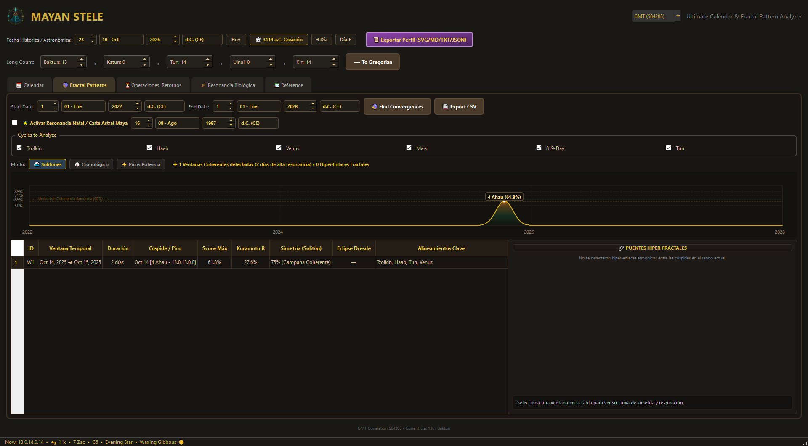
</p>

- **Continuous Kuramoto Gauge**: Visual indicator showing collective phase coherence $R$ and angle $\Psi$.
- **Dresden Codex Warning Banner**: Highlights active solar/lunar eclipse corridors.
- **Wave Packet & Soliton Table**: Identifies multi-day convergence clusters where multiple sacred periods coincide across deep history.
- **Personal Natal Resonance**: Computes individualized alignment scores with personal birth matrices.

### 3. ⏳ Operaciones & Retornos

<p align="center">
  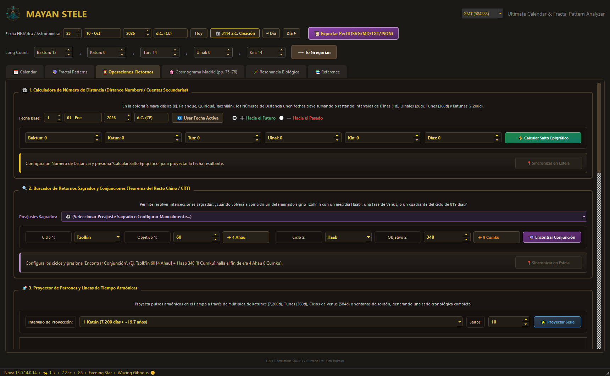
</p>

- **Distance Numbers**: Add or subtract historical vectors ($k$ Katún, $t$ Tún, $u$ Uinal, $k$ K'in) to any epoch with full BCE/CE support.
- **CRT Exact Cycle Solver**: Solves simultaneous modular congruences using the Chinese Remainder Theorem:
  - *Calendar Round Return* (Tzolk'in + Haab' = 18,980 days / ~52 years)
  - *Venus Great Cycle* (Tzolk'in + Venus = 37,960 days / ~104 years)
  - *Tzolk'in-Tún Grand Conjunction* (260 + 360 = 93,600 days / 260 Tún)
- **Harmonic Pattern Projector**: Projects forward/backward steps over arbitrary cycle frequencies into deep time.
- **Cuentas Serpentinas y Números de Anillo (Dresden Codex pp. 61–69)**: Explores Deep Time chronology (~12.3 to 12.5 million days / >33,000 years) using Ring Numbers tied with red ribbons to subtract intervals prior to the Creation date 13.0.0.0.0 4 Ahau 8 Cumku (3114 BCE) into primordial chaos, then projecting forward to historical arrival dates. Includes one-click stele synchronizers for both Primordial Base Dates and Terminal Arrival Dates.
- **Cómputo de 364 Días y Estaciones Cósmicas (Dresden Codex pp. 65a–69b)**: Solves the exact next seasonal transitions (Equinoccio de Primavera, Solsticio de Verano, Equinoccio de Otoño, Solsticio de Invierno) and the 1,820-day Grand Return alignment with Tzolk'in, featuring 1-click synchronization to the main calendar stele.
- **La Tabla de Marte y la Bestia Celeste (Dresden Codex pp. 43b–45b)**: Interactive section computing next station jumps for all 10 canonical stations of 78 days (3 Lamat, 3 Cimi, 3 Kan, 3 Ik, 3 Ahau, 3 Etznab, 3 Cib, 3 Ix, 3 Eb, 3 Oc), the 9,360-day Super-Tun ($12\text{ Marte} = 26\text{ Tuns} = 36\text{ Tzolk'in}$), and the 56,940-day Grand Return ($73\text{ Marte} = 156\text{ Haab'} = 3\text{ Ruedas Calendáricas}$) with direct 1-click stele alignment.
- **Almanaques de Madrid: Portadores del Año (Cuch Hab), Ciclo del Maíz & Apicultura Melipona (Códice Tro-Cortesiano)**: Calculates and executes 1-click stele synchronizations for the upcoming Maya New Year (0 Pop inaugurating the new annual Year Bearer), entrance to the critical 5-day Uayeb period, sacred maize sowing (*Pak'al* in day Kan), and the opening of *Melipona* bee hives (*jobones*) in the 52-day cycle under winged god *Ah Muzencab*.

<p align="center">
  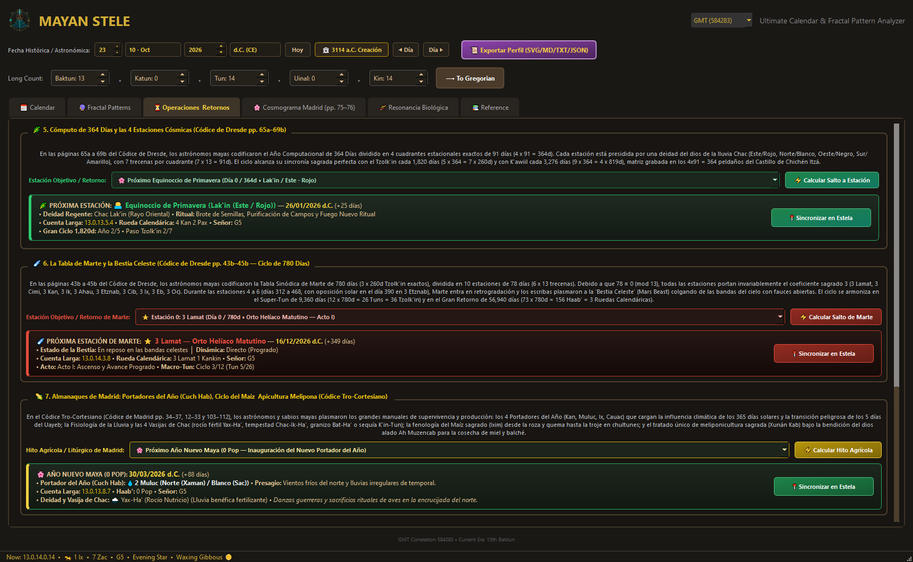
</p>

### 4. 🌸 Cosmograma de Madrid (pp. 75–76)

<p align="center">
  
</p>

- **Interactive 4-Petaled Cosmic Flower (Cruz de Malta Mesoamericana)**: Full vector rendering engine (`MadridCosmogramWidget`) reproducing the grand 2-page cosmogram of the Madrid Codex with responsive dynamic scaling.
- **The 260-Day Pilgrimage Ribbon (*Xocan Be*)**: Continuous winding loop of exactly 260 day nodes (65 days per cardinal petal). Sacred human footprints (*huellas de pies divinos*) stamped along the path mark the direction of cosmic pilgrimage.
- **Central Cartouche (*Axis Mundi*)**: Depicts the primordial ancestral grandparents **Itzamná** (God D, wisdom and writing) and **Ixchel** (Goddess I, weaving, medicine and moon) enthroned at the cosmic navel under the World Tree *Wacah Chan*.
- **The 4 Cardinal Ceiba Trees & Year Bearers**:
  - 🌸 **Este (Lak'in / Rojo)**: *Chac Imixche* • Portador *Kan* 🌾 • Regente *K'inich Ahau* • Vasija *Yax-Ha'*.
  - 💧 **Norte (Xaman / Blanco)**: *Sac Imixche* • Portador *Muluc* 💧 • Regente *Ah Puch* • Vasija *Chac-Ik-Ha'*.
  - 🐆 **Oeste (Chik'in / Negro)**: *Ek Imixche* • Portador *Ix* 🐆 • Regente *Balam* • Vasija *Bat-Ha'*.
  - ⚡ **Sur (Nohol / Amarillo)**: *K'an Imixche* • Portador *Cauac* ⚡ • Regente *Chac* • Vasija *K'in-Tun*.
- **4 Intercardinal Bacabs**: Corner medallions of the Sky Bearers and their celestial birds (*Bacab Cantzicnal* with Quetzal 🦜, *Bacab Zac Cimi* with Muan Owl 🦉, *Bacab Hosanek* with Hawk 🦅, and *Bacab Hobnil* with Melipona Bee 🐝).
- **Interactive Navigation & Hover HUD**: Hover over any of the 260 nodes to inspect its Tzolk'in sign, tone, quadrant, and meaning in the stone HUD. Click any node to instantly jump to that date across the entire application with 1-click stele synchronization.
- **Cosmic Pilgrimage Animation**: Play/Pause automated walking timer with adjustable speed slider (20ms to 350ms) and optional calendar date advance.
- **Sacred Orientation Toggle**: Switch seamlessly between authentic **Mesoamerican Orientation (East at the Top)** and Cartesian Orientation (North at the Top).
- **Quadrant Focusing**: Instant filters to spotlight individual cardinal petals or view the complete quadripartite universe.

### 5. 🧬 Resonancia Biológica

<p align="center">
  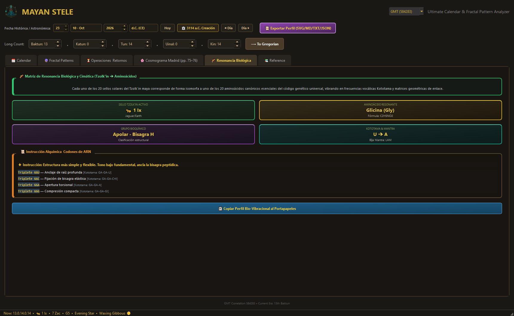
</p>

- **20 Solar Seals $\to$ 20 Amino Acids**: Symmetrical mapping grounded in molecular charge, hydropathy, and aromaticity.
- **RNA Genetic Triplets**: Direct codon assignments for every Tzolk'in sign.
- **Kototama Phonetics & Bīja Mantras**: Traditional vocalic frequencies associated with daily vibrational archetypes.

### 6. 📚 Enciclopedia & Basalt Obsidian Styling

<p align="center">
  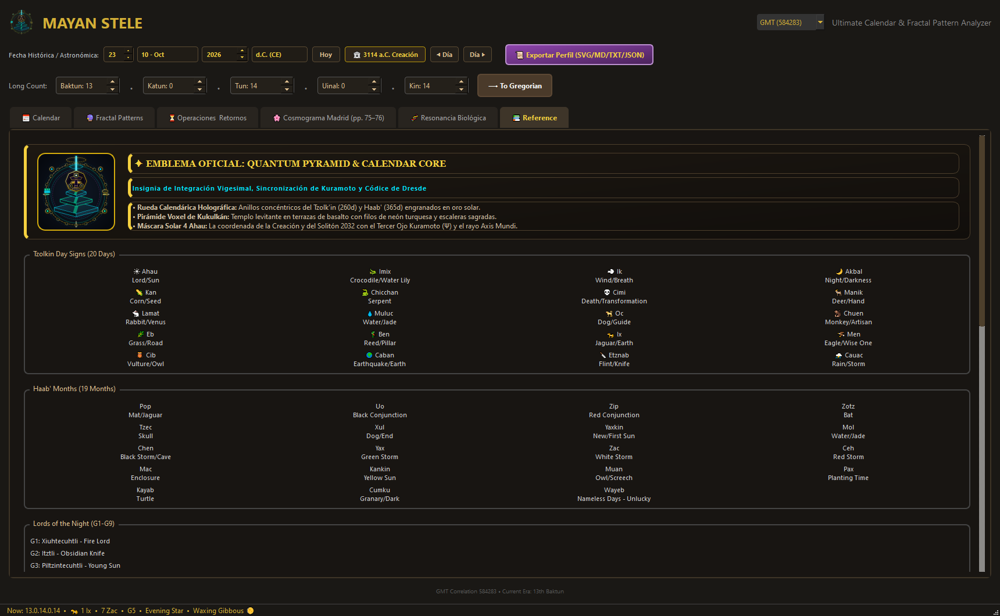
</p>
- Comprehensive scholarly reference for all 13 Galactic Tones, 9 Underworld Lords, Venus Helical Risings, and Lunar Patrons.
- **Quantum Insignia & Showcase**: Features the official *Quantum Pyramid & Calendar Core* vector emblem integrated into the application header, window icon, and reference codex. Explore all 5 design variants in [`assets/logos/showcase.html`](./assets/logos/showcase.html).
- Seamless Dark Obsidian and Basque Gold CSS palettes without white artifact bleeds.

---

## Mayan Epigraphy & Linguistic Engine: Ah Ts'ib (`mayan-lang.py`)

A groundbreaking computational epigraphy and linguistic workstation transforming Mayan calendar glyphs into a complete **2D Logosyllabic Composition, Syllabification, and Hieroglyphic Decryption Suite**.

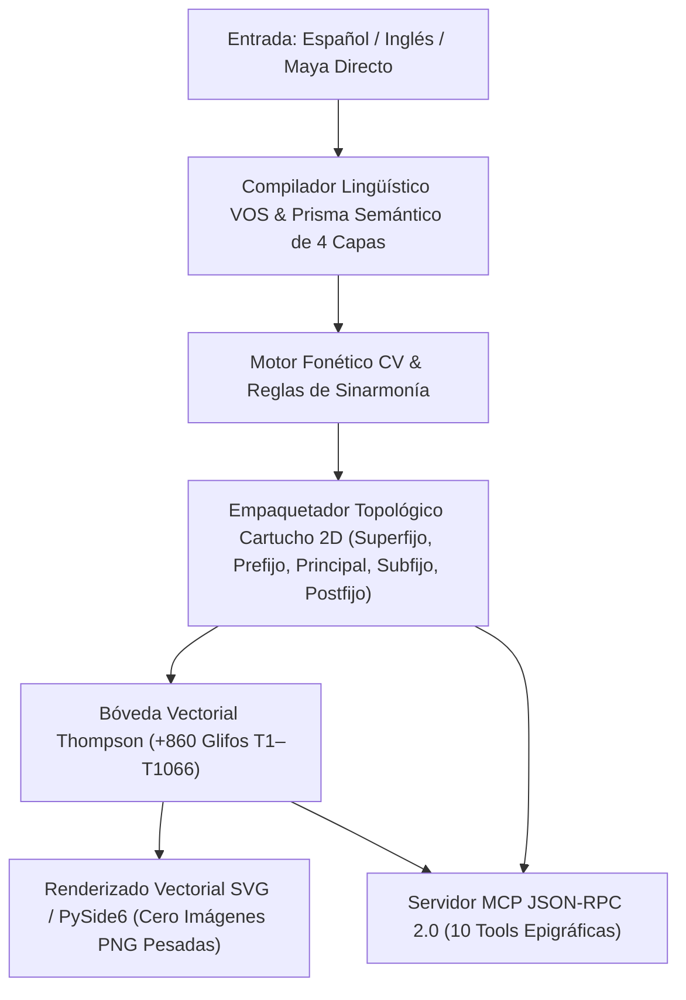

### 1. 📜 Compositor ES/EN ➔ Maya & Prisma Semántico de 4 Capas
Translates natural language sentences into Classical Ch'olti' VOS syntax and passes them through the **4-Layer Semantic Prism**:
- **Layer 1: Surface Linear** (ES / EN literal gloss).
- **Layer 2: Morpho-Topological & Positional Geometry** (quad-block coordinates: A1, B1, A2, B2).
- **Layer 3: Harmonic Resonant Accord & Diphrasisms (*Tz'ak*)** (sacred poetic couplings).
- **Layer 4: Biocymatic & Kototama Vector** (vowel cadence, Hz resonance frequency, elemental polarity).

<p align="center">
  
</p>

### 2. 🖋️ Taller del Escriba (Cartucho 2D Topológico)
Interactive studio to assemble complex hieroglyphic cartouche blocks according to Classical Maya epigraphic syntax:
- **Main Sign (*Núcleo Principal*)**: The foundational logogram or primary syllable.
- **Superfix (*Superfijo*) & Subfix (*Subfijo*)**: Grammatical affixes positioned above and below.
- **Prefix (*Prefijo*) & Postfix (*Postfijo*)**: Ergative pronouns and aspectual markers left and right.
- **Infix (*Infijo*)**: Embedded interior graphemes.
- **Vigesimal Coeficient (0–19)**: Bars and dots placed to the left or top.

<p align="center">
  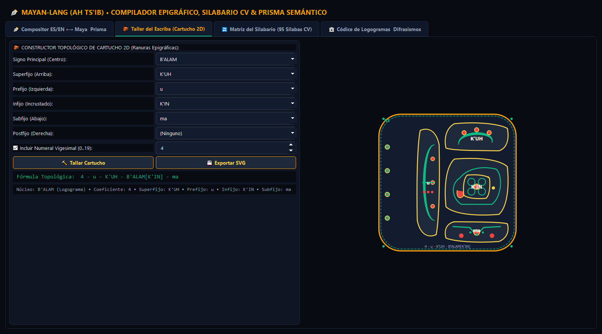
</p>

### 3. 🔣 Matriz del Silabario Fonético (95 Sílabas CV & Resonancia Kototama)
Complete $19 \times 5$ phonetic grid (19 consonants $\times$ 5 vowels = 95 syllables CV) mapping ancient acoustic radicals to specific vocalic diacritics and bio-acoustic Kototama resonance frequencies (432 Hz, 528 Hz, 639 Hz, 741 Hz, 852 Hz):

<p align="center">
  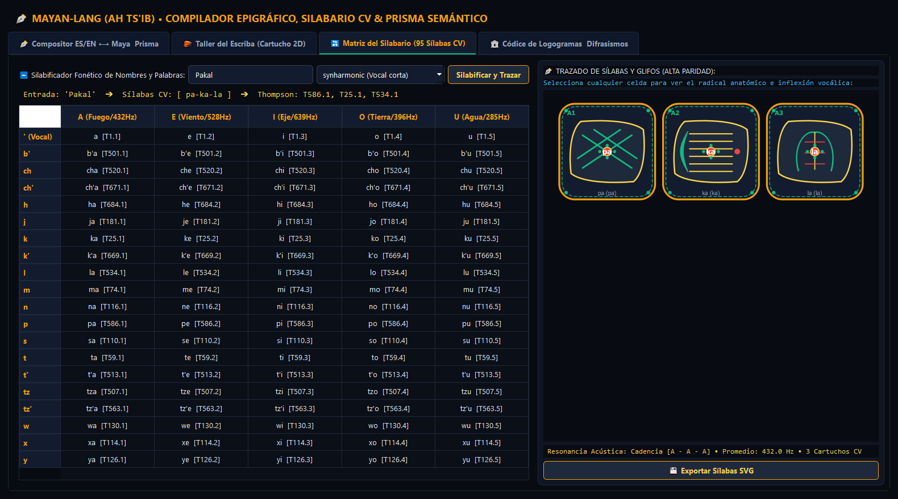
</p>

### 4. 🏛️ Corpus Thompson (+860 Glifos Mayas: T1–T1066) & Códice
Complete archaeological catalog indexing all Thompson glyphs (T1 to T1066) and Macri-Looper MHD codes:
- **Zero Heavy Raster Images**: Entire catalog stored as lightweight normalized vector Bézier silhouettes (**~260 KB total corpus** vs. 120 MB of static PNGs).
- **8 Taxonomic Families**: Affixes (T1–T499), Sacred Fauna (Zoomorphic), Deidades y Reyes (T1000–T1066), Astronomía y Cosmología, Antropomorfos, Atavíos y Artefactos, Botánica Sagrada y Geometría Sagrada.
- **Continuous Fourier Morphing (EFD)**: Interactive slider interpolating between abstract geometric contour ($\alpha = 0.0$) and sacred cephalomorphic deity profile ($\alpha = 1.0$).
- **Direct Workshop Assembly**: One-click **"Insertar en Cartucho ➔"** button to inject any of the +860 glyphs directly into the active cartouche workshop!

<p align="center">
  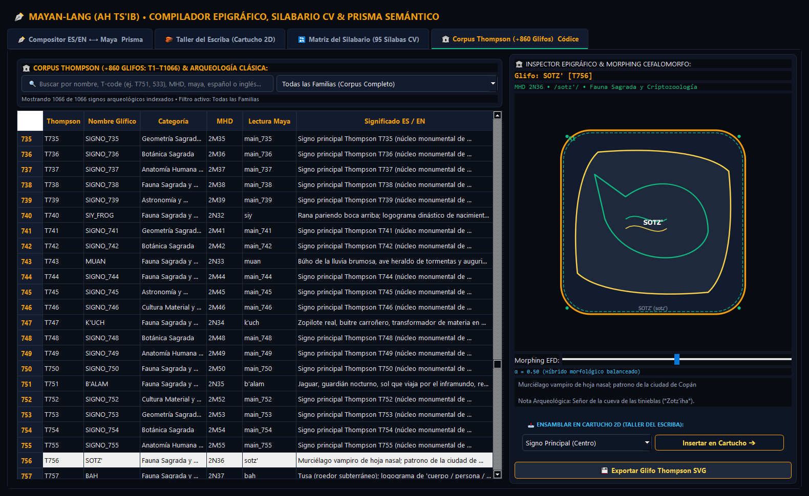
</p>

---

## Multi-Format Profile Exporter (`mayan_exporter.py`)

Generate full chronological and epigraphic dossiers directly from the GUI or via the MCP server:

- **SVG Vector Stele (`.svg`)**: Hieroglyphic stone slab illustration containing Long Count glyphs, Tzolk'in/Haab' cartouches, Kuramoto synchronization wheel, and biocymatic glyphs.
- **Markdown Dossier (`.md`)**: Comprehensive research report with mathematical tables, alignments, and biological correspondences.
- **ASCII Monument (`.txt`)**: Terminal-rendered ancient monument banner suitable for text consoles.
- **JSON Payload (`.json`)**: Full structured machine-readable document for pipelines and LLM ingestion.

---

## Installation & Quickstart

### Prerequisites
- Python 3.8 or higher
- Windows, macOS, or Linux

### Setup
```bash
# Clone repository
git clone https://github.com/plantacerium/MayanCalendar.git
cd MayanCalendar

# Create virtual environment (optional but recommended)
python -m venv .venv
source .venv/bin/activate  # On Windows: .venv\Scripts\activate

# Install dependencies
pip install PySide6
```

### Launch the Desktop Applications
```bash
# 1. Main Calendar, Fractal Analyzer & Cosmogram GUI
python mayan-stele.py

# 2. Mayan Epigraphy, Syllabary & Thompson Corpus Suite (Ah Ts'ib)
python mayan-lang.py
```

### Run the MCP Servers Standalone (stdio JSON-RPC 2.0)
```bash
# Unified Server (Chronometry + Epigraphy: 24 Tools)
python mayan_mcp_server.py

# Standalone Epigraphy & Linguistic Server (10 Tools)
python mayan_lang_mcp_server.py
```

---

## Historical & Significant Dates to Explore

| Gregorian Date | Long Count | Tzolk'in | Haab' | Cosmic Context |
|----------------|------------|----------|-------|----------------|
| **Aug 11, 3114 BCE** | 0.0.0.0.0 | 4 Ahau | 8 Cumku | Maya Creation Epoch |
| **Dec 21, 2012** | 13.0.0.0.0 | 4 Ahau | 3 Kankin | Completion of the 13th Baktún |
| **Dec 01, 0940** | 10.5.12.6.0 | 4 Ahau | 8 Cumku | Peak Wave Packet W13 (80.0% Harmonic Score) |
| **Mar 11, 2032** | 13.0.19.9.0 | 4 Ahau | 8 Cumku | Soliton W72, $R=57.6\%$, Dresden Solar Eclipse Window |
| **Jan 02, 2045** | 13.1.12.9.0 | 4 Ahau | 8 Cumku | Soliton W3, Dresden Lunar Eclipse Window |

---

## License & Citation

Distributed under the **GPL V3 License**. See [`LICENSE`](./LICENSE) for full details.

If you use this software or the MCP server in your research, computational chronometry, or agentic systems, please cite:

```bibtex
@software{mayan_stele_mcp_2026,
  author = {Plantacerium and Contributors},
  title = {Mayan Stele: Ultimate Calendar, Fractal Pattern Analyzer & MCP Server},
  year = {2026},
  url = {https://github.com/plantacerium/MayanCalendar}
}
```

---

*"Time is not an arrow, but a symphony of concentric spirals resonating across deep space."*
